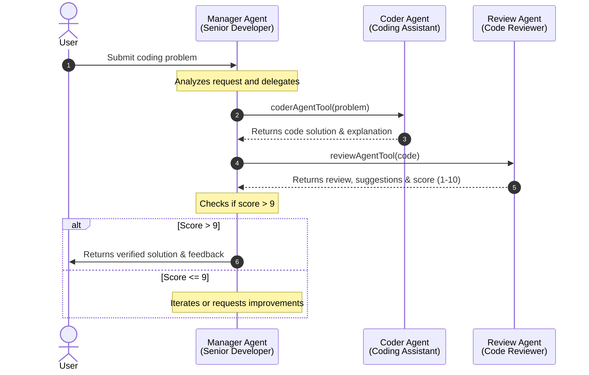

# Multi-Agent Coding & Review System

A hierarchical multi-agent orchestration system built with **LangChain** and **Mistral AI**. The system automates software engineering workflows through collaborative AI roles—pairing a developer agent and an automated code reviewer under a senior developer supervisor agent to ensure high-quality, reviewed code solutions.

---

## 📑 Table of Contents

- [Overview](#-overview)
- [Architecture & Workflow](#-architecture--workflow)
- [Agent Roles](#-agent-roles)
- [Project Structure](#-project-structure)
- [Prerequisites](#-prerequisites)
- [Getting Started](#-getting-started)
- [Environment Variables](#-environment-variables)
- [Usage](#-usage)
- [Observability with LangSmith](#-observability-with-langsmith)
- [Customization](#-customization)
- [License](#-license)

---

## 🌟 Overview

Writing reliable code requires planning, handling edge cases, and code reviews. This project implements a **Hierarchical Multi-Agent System (Supervisor Pattern)**:

1. **Manager Agent (Senior Developer)** receives the problem statement.
2. **Coder Agent** crafts an edge-case resilient implementation with explanations.
3. **Review Agent** inspects quality, maintainability, and rates the code (1–10).
4. **Manager Agent** evaluates the review and delivers the result to the user only when the quality score surpasses the threshold (> 9).

---

## 🏗 Architecture & Workflow



---

## 🤖 Agent Roles

| Agent | Role | Capabilities & Constraints |
| :--- | :--- | :--- |
| **Manager Agent** | Senior Developer / Orchestrator | Coordinates the workflow, calls sub-agent tools (`coderAgentTool`, `reviewAgentTool`), and enforces quality gatekeeping (score > 9). |
| **Coder Agent** | Coding Assistant | Implements solutions, accounts for edge cases, and produces clear, structured explanations. |
| **Review Agent** | Quality Reviewer | Evaluates code quality, readability, maintainability, scores solutions from 1 to 10, and highlights potential issues. |

---

## 📁 Project Structure

```text
multi-agent-system/
├── agent.js          # Agent definitions, system prompts, and tool interfaces
├── index.js          # Application entry point and invocation example
├── package.json      # Project dependencies and metadata (ES Module)
├── .env.example      # Sample configuration template
├── .gitignore        # Git ignore rules (node_modules, .env)
└── README.md         # Project documentation
```

---

## ⚙️ Prerequisites

- **Node.js**: `v18.0.0` or higher
- **Mistral AI API Key**: Sign up at [Mistral AI Console](https://console.mistral.ai/)
- **LangSmith API Key** *(Optional)*: Sign up at [LangSmith](https://smith.langchain.com/) for trace visualization and monitoring

---

## 🚀 Getting Started

### 1. Clone the repository

```bash
git clone https://github.com/abhiii1120/multi-agent-system.git
cd multi-agent-system
```

### 2. Install dependencies

```bash
npm install
```

### 3. Configure environment variables

Copy `.env.example` to create your `.env` file:

```bash
cp .env.example .env
```

Open `.env` and fill in your API credentials:

```ini
MISTRAL_API_KEY=your_mistral_api_key_here
```

### 4. Run the system

```bash
npm start
# or
node index.js
```

---

## 🔑 Environment Variables

| Variable | Required | Description |
| :--- | :---: | :--- |
| `MISTRAL_API_KEY` | **Yes** | API key used for querying Mistral AI models. |
| `LANGSMITH_TRACING` | No | Set to `true` to enable execution tracing in LangSmith. |
| `LANGSMITH_ENDPOINT` | No | LangSmith API endpoint URL (default: `https://api.smith.langchain.com`). |
| `LANGSMITH_API_KEY` | No | API key for authenticating with LangSmith. |
| `LANGSMITH_AGENT_ID` | No | Identifier/tag for the agent instance. |
| `LANGSMITH_AGENT_ENVIRONMENT` | No | Deployment environment label (e.g. `development`, `production`). |

---

## 💻 Usage

To run queries through the multi-agent system, modify the input message in [`index.js`](file:///c:/Users/Abhinay%20Mhatre/Projects/practice_projects/multi-agent-system/index.js):

```javascript
import "dotenv/config";
import managerAgent from "./agent.js";
import { HumanMessage } from "langchain";
import { awaitAllCallbacks } from "@langchain/core/callbacks/promises";

const res = await managerAgent.invoke({
  messages: [
    new HumanMessage("Write a function to reverse a string in JavaScript")
  ]
});

console.log(res);

// Wait for any pending observability callbacks before exiting
await awaitAllCallbacks();
```

---

## 📊 Observability with LangSmith

This project includes integrated support for **LangSmith** to monitor agent activity in real time. Once enabled, you can inspect:

- Exact tool inputs and outputs (`coderAgentTool` and `reviewAgentTool`).
- Step-by-step reasoning and thought process of each agent.
- Token consumption, latency, and model metrics.
- Call hierarchies between parent manager and child worker agents.

---

## 🛠 Customization

- **Change the Model**: In [`agent.js`](file:///c:/Users/Abhinay%20Mhatre/Projects/practice_projects/multi-agent-system/agent.js), change `ministral-14b-2512` to other Mistral models like `mistral-large-latest` or `codestral-latest`.
- **Adjust Quality Gate**: Edit the system prompt in `managerAgent` inside [`agent.js`](file:///c:/Users/Abhinay%20Mhatre/Projects/practice_projects/multi-agent-system/agent.js) to tune scoring thresholds or feedback loops.
- **Add New Agents**: Add additional specialized agents (e.g., Unit Test Writer, Security Auditor, Documentation Writer) by creating new agent instances and wrapping them in LangChain `tool()` definitions.

---

## 📄 License

This project is open-source and available under the [ISC License](file:///c:/Users/Abhinay%20Mhatre/Projects/practice_projects/multi-agent-system/package.json).
